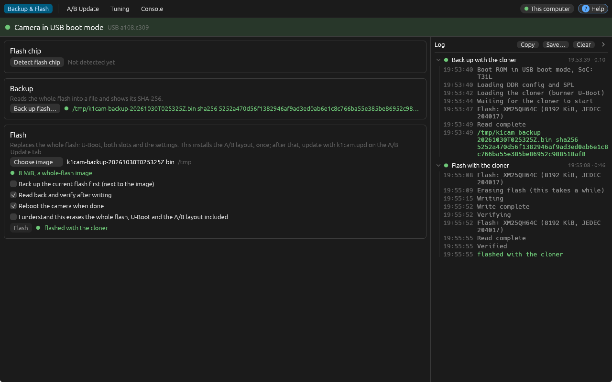
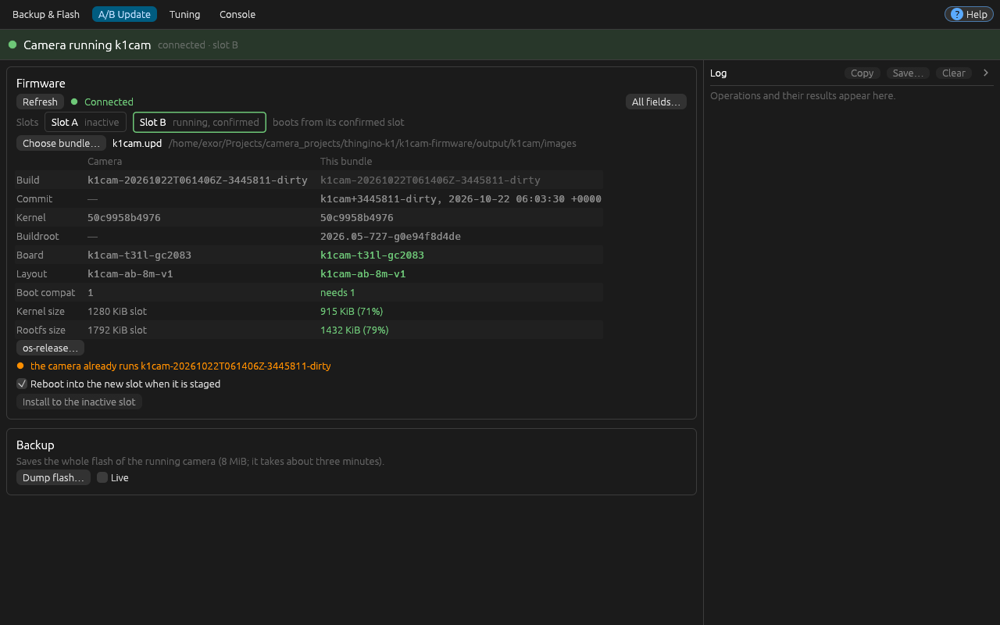
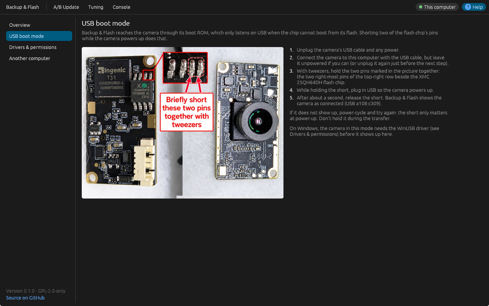

# k1cam-flasher

A small, single-binary GUI to back up, flash and update the Creality K1 camera (Ingenic T31L, 8 MiB SPI NOR) on Linux, Windows and macOS, and the same operations as a command line, which also builds as a small static binary for the Linux boards a camera gets plugged into (see [Command line](#command-line) and [Static builds](#static-builds)).

- **Backup & Flash (cloner)**: full read and full flash with the Ingenic cloner protocol, through the boot ROM's USB boot mode, ported from [thingino-dfu](https://github.com/gtxaspec/thingino-dfu) (T31 family only), with read-back verification.
- **A/B Update (k1cam)**: dump, update the inactive slot, reboot into the trial or cancel it, over the k1cam UVC extension unit protocol (same as `uvcdctl firmware`). On Linux it uses the uvcvideo XU ioctl on `/dev/videoN` (needs access to the video node, e.g. the `video` group); on macOS it uses libusb (untested). Not available on Windows. The tab shows what the connected camera runs (build, kernel commit, slots, boot state) next to what the chosen `k1cam.upd` holds (build, commit, kernel, sizes against the slot sizes, and its os-release, after checking its digests), and whether the camera would take it. `k1cam-flasher FILE.upd` opens the A/B tab with that bundle.
- **Tuning** (Linux): press *Connect* for the camera's picture, live (MJPEG at a size and rate you choose), as large as the window allows with every image control still in view: picture, exposure, white balance, noise, view and encoder settings, as `uvcdctl` names them, flowing down columns beside and below the picture. The camera keeps every change itself; an active control that differs from its default stands out, clicking its name puts the default back, and *Factory defaults* resets them all. Exposure time and white balance temperature have an *auto* check box on their row, and while it is on the slider follows what the camera chooses (white balance once uvcd reports it). *Overlays* on the picture show where the camera meters exposure and how bright each of its zones is, clipped highlights and crushed shadows, a histogram and a framing grid, and the picture reads out the pixel under the pointer. *Snapshot* saves the frame on screen as the camera sent it (JPEG). The preview runs only while the tab is shown; *Pause* frees the video, and *Disconnect* closes tuning entirely.
- **Console**: the camera's USB serial console (CDC-ACM, same USB ids). *Connect* works once the console is detected; press it to open the console. It doesn't connect while another program has the port open (Linux), so that program keeps its output; while connected, other programs can't open the port until you press *Disconnect*. Type a line and press Enter (an empty line wakes the prompt), *Ctrl-C* stops what runs in the foreground. After a reboot or unplug, press *Connect* again.
- **Help** (*Help*, top right): forcing USB boot mode (see below), drivers and permissions.

The status bar under the tabs shows whether the open tab's device is attached (green when it is) and follows a running operation (blue): its progress, what it last said, the time taken and left, and *Cancel*. Beside Backup & Flash and A/B Update, the log shows each operation under a heading with when it started, how long it took and how it ended; it opens by itself when one starts, and folded away to a strip it counts the operations finished since, in red if one failed. A tab's lines are all there from the start, so nothing moves as results come in. Dropping a `k1cam.upd` on the window opens it on the A/B tab, a `.bin` image on Backup & Flash. Closing the window while an operation runs asks first.

| Backup & Flash | A/B Update | Help |
|---|---|---|
|  |  |  |

> Not yet tested against real hardware. Take and check a backup before relying on it.

## Getting the camera into USB boot mode

The bootrom only listens on USB when the SoC cannot boot from the NOR, so you short two NOR pins while it powers up.


1. Unplug the camera from power and USB.
2. With tweezers, hold together the two right-most pins of the top-right row of pins beside the XMC 25QH64DH NOR chip (marked in the picture).
3. Keep holding while you plug in USB so the camera powers up.
4. After about a second release the short. `lsusb` shows `a108:c309` and the app shows a green status.

The short only matters at power-up. If the device does not appear, power-cycle and retry. The same text is in the app's help (*Help*).

## Driver setup

Running k1cam firmware uses `f055:4b31` (unofficial FOSS community VID,
`4b31` = "K1"), manufacturer `k1cam`, product `K1 Camera`. This is a project
convention, not an exclusive allocation. Earlier `1d6b:0110` firmware is
also recognized so updates and rollback can cross the ID change. The boot
ROM's cloner identity remains `a108:c309`. See the
[firmware USB identity notes](https://github.com/itzexor/k1cam-firmware/blob/k1cam/USB-IDENTITY.md)
for the rationale and collision checks.

- **Linux**: `sudo cp udev/99-k1cam-flasher.rules /etc/udev/rules.d/ && sudo udevadm control --reload && sudo udevadm trigger`. A/B Update and Tuning need access to the camera's `/dev/video*` node (the `video` group), the console to `/dev/ttyACM*` (the `dialout` group, `uucp` on Arch).
- **Windows**: bind WinUSB to `a108:c309` with [Zadig](https://zadig.akeo.ie/) while the camera is in USB boot mode.
- **macOS**: nothing to install.

## Using it

Attaching a camera or opening a tab does not open its console, start video,
or read its controls. On A/B Update, *Connect* reads the firmware information
and *Refresh* reads it again. Choosing a valid `.upd` also reads an attached
camera's information for comparison. Firmware operations disconnect tuning
and the console and wait for their device access to finish before starting;
press *Connect* again to use them afterward. While an operation runs, file
loading (including drops) and camera controls are locked; the tabs, the log
and Cancel remain available.

- Backup: *Detect flash chip* checks the link, *Back up flash...* saves the 8 MiB image and shows its SHA-256. Backups are named for the time in UTC (`k1cam-backup-20261020T073812Z.bin`).
- Flash: choose `k1cam.bin` (exactly 8 MiB; the tab checks the size when you choose it), optionally back up first, tick the confirmation, press *Flash*. This replaces U-Boot and installs the A/B layout once. After that, update with `k1cam.upd` on the A/B tab.
- Update: choose `k1cam.upd` and compare it with what the camera runs; the bundle is read again when the file changes on disk, and what is shown is what gets installed. The camera is sent the bundle only, not the release information after it, so cameras on firmware from before that section was added take these files too.
- Progress shows in the status bar with the time taken and, for long steps, the time left; each operation's outcome shows beside the button that started it and in the log, which *Copy* and *Save…* take as text.

## Command line

Every operation also runs without the GUI; `k1cam-flasher help` lists them:

```
k1cam-flasher info                      # a running camera's firmware information
k1cam-flasher update k1cam.upd          # install into the inactive slot, reboot into the trial
k1cam-flasher reboot | cancel           # start or withdraw a staged trial
k1cam-flasher dump backup.bin [--live]  # the whole flash from a running camera
k1cam-flasher detect                    # cloner: identify the flash chip
k1cam-flasher backup backup.bin         # cloner: read the whole flash
k1cam-flasher flash k1cam.bin --yes     # cloner: replace the whole flash
k1cam-flasher check k1cam.upd           # what a bundle holds, no camera needed
```

`flash` backs up next to the image, verifies and reboots unless told not to (`--no-backup`, `--no-verify`, `--no-reboot`); `update --no-reboot` only stages. Progress and messages go to stderr, results to stdout; the exit status is 0 on success, 1 on failure and 2 for usage errors. Output files are never overwritten. Ctrl-C stops an operation cleanly (a dump or upload ends its session on the camera); a second Ctrl-C quits at once.

## Static builds

Without the GUI (`--no-default-features`) the flasher is about 1 MiB and depends on nothing but Rust's standard library: on Linux it talks to usbfs and V4L2 itself instead of using libusb, so it links statically for musl targets with no C cross toolchain. `.cargo/config.toml` links the ARM targets with the `rust-lld` that ships with Rust.

```
rustup target add aarch64-unknown-linux-musl      # e.g. Raspberry Pi OS, 64-bit
cargo build --release --no-default-features --target aarch64-unknown-linux-musl
# -> target/aarch64-unknown-linux-musl/release/k1cam-flasher (static)
```

The same works for `x86_64-unknown-linux-musl` and `armv7-unknown-linux-musleabihf` (32-bit Raspberry Pi OS); CI builds all three. On the target it needs access to `/dev/video*` (A/B) and `/dev/bus/usb` (cloner), e.g. as root or with the udev rule. MIPS boards are a tier 3 Rust target: nightly Rust with `-Z build-std=std,panic_abort --target mipsel-unknown-linux-musl` and a musl cross gcc as the linker (untested).

## Build

`cargo build --release` builds the GUI. It needs a C toolchain (for a Wayland build script on Linux, and libusb, which is vendored, on Windows and macOS); on Linux the build needs no extra GUI libraries beyond the usual X11/Wayland ones at runtime. CI in `.github/workflows/build.yml` builds the GUI on all three OSes and the static command-line binaries.

## Embedded cloner data

`src/cloner/data/` holds the burner SPL and U-Boot (GPL, from thingino-dfu), the T31X DDR config, the SoC-detect MIPS stub, the partition marker and the SPI NOR descriptors, generated byte-exactly with thingino-dfu's own code. Regenerate with `tools/gen-cloner-data/gen.sh /path/to/thingino-dfu-historical`.

## License

Mixed, per file (SPDX identifiers in the sources, texts in `LICENSES/`):

- **MIT**: the GUI, the console, the tuning tab, the command line, the k1cam A/B protocol client, the bundle parser, the USB, Linux and V4L2 device layers (`src/usb.rs`, `src/linux.rs`, `src/v4l2.rs`), udev rule and build files.
- **GPL-2.0-only**: `src/cloner/` and `tools/gen-cloner-data/`, which are derived from [thingino-dfu](https://github.com/gtxaspec/thingino-dfu), and the embedded burner SPL/U-Boot and generated blobs in `src/cloner/data/` (GPL U-Boot, thingino-dfu output).
- **CC0-1.0** (public domain): the photo `docs/short-nor-pins.jpg`, the synthetic test bundle `tests/data/golden.upd` and this documentation.

The built binary links the GPL-2.0-only code, so it as a whole is distributed under GPL-2.0-only; the source for it is this repository.
